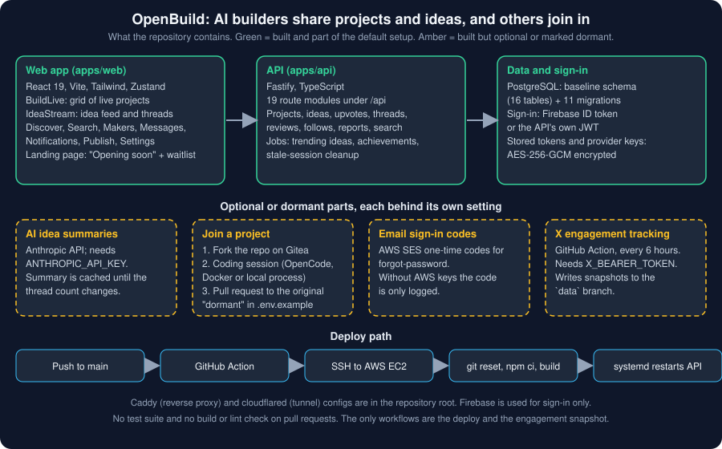

# OpenBuild

A web platform where AI builders publish what they are building, share ideas, and let others join a project.

**Status:** pre-launch. The landing page says "Opening soon" and collects waitlist emails. The app (openbuild.world) and git host (git.openbuild.world) both answered HTTP 200 when checked on 2026-11-24.



## Definitions

| Term | Meaning |
| --- | --- |
| **BuildLive** | A grid of live projects. Each project has a stage, contributors, tools used, and potential applications. Anyone can browse. |
| **IdeaStream** | A feed of ideas. An idea has a title, description, domain and tags, threaded replies, and upvotes. Ideas are ranked by a trending job. |
| **Publish** | Posting either a build (project) or an idea. |
| **Stage** | A text field on a project (up to 20 characters). The earlier README named five stages: Ideating, Prototyping, Alpha, Beta, GA. The code does not enforce them. |
| **Join** | Contribute to a project: fork its repository on Gitea, run a coding session against the fork, and send the result back as a pull request. Marked "dormant" in `apps/api/.env.example`. |
| **Coding session** | A sandboxed OpenCode session, started as a Docker container (`SESSION_MODE=docker`) or a local process (`SESSION_MODE=process`). |
| **Gitea** | The self-hosted git service that holds forks and pull requests. Optional: `GITEA_AUTO_PROVISION=false` skips it. |

## How it works

1. **Browse.** Projects and ideas can be read without an account.
2. **Sign in.** The API accepts its own JWT or a Firebase ID token. Email one-time codes for forgot-password use AWS SES; without AWS keys the code is only logged.
3. **Publish and discuss.** Signed-in users publish builds and ideas, upvote, reply in threads, review, follow makers, message, and report content.
4. **Summarise.** An idea thread can be summarised through the Anthropic API (needs `ANTHROPIC_API_KEY`). The summary is cached until the thread count changes.
5. **Join (dormant).** The Join flow in the definitions table. The project page has an "Open workspace" button that starts it.

## Status by category

| Category | Done | Pending (planned) | Not planned (gaps) |
| --- | --- | --- | --- |
| **Product features** | BuildLive, IdeaStream, Discover, Search, Makers, Messages, Notifications, Publish, Settings, upvotes, threads, reviews, follows, reports, achievements job, trending job, waitlist | Public opening (landing page says "Opening soon") | No roadmap file in the repository |
| **Join and coding sessions** | Fork, session and pull-request code in `session.service.ts`, `session-process.service.ts`, `git.service.ts` | - | Marked dormant. No record in the repository of it running end to end. |
| **AI summaries** | Implemented in `llm.service.ts` with caching | - | Needs an Anthropic key; no tests |
| **Sign-in** | JWT and Firebase ID token, email codes via SES | - | `ENCRYPTION_KEY` falls back to `JWT_SECRET` if unset (the example file says to set both) |
| **Data** | Baseline `schema.sql` (16 tables), 11 migrations, and idempotent `ensure...Columns()` functions run at every server start | - | Schema has two sources of truth: `schema.sql` plus migrations, and the `ensure` functions |
| **Deploy** | GitHub Action on push to `main`: SSH to AWS EC2, `git reset --hard`, `npm ci`, build, restart the systemd unit. Caddy and cloudflared configs. | - | Deploy runs on every push to `main` without a test or build check first |
| **Engagement tracking** | GitHub Action every 6 hours saves X engagement snapshots to the `data` branch (needs `X_BEARER_TOKEN`) | - | - |
| **Testing** | - | - | No test suite. No build or lint check on pull requests. |
| **Documentation** | This README | - | `apps/web/README.md` is the unchanged Vite template. No API reference. |
| **Repository hygiene** | MIT `LICENSE`; `.env` ignored; `.env.example` files | - | `apps/web/.env.production` is tracked. Its comment says it holds public client keys (Firebase web config, imgbb) that Vite inlines into the browser bundle. |

## Repository layout

```
apps/api/     Fastify API, route modules in src/routes, services, jobs, migrations, session Dockerfile
apps/web/     React app, pages in src/pages
deploy/       Server setup, deploy script, systemd unit, production docker compose
scripts/      Local development helpers
.github/      Deploy workflow, engagement tracking workflow
Caddyfile, cloudflared-config.yml, firebase.json
```

## Run locally

```bash
npm install
npm run infra                      # Postgres, Redis, Gitea through Docker Compose
cp apps/api/.env.example apps/api/.env
cp apps/web/.env.example apps/web/.env
cd apps/api && npm run migrate && cd ../..
npm run dev                        # API and web together
```

Fill in the two `.env` files first. `npm run build` builds both workspaces.

## License

MIT. See `LICENSE`.
